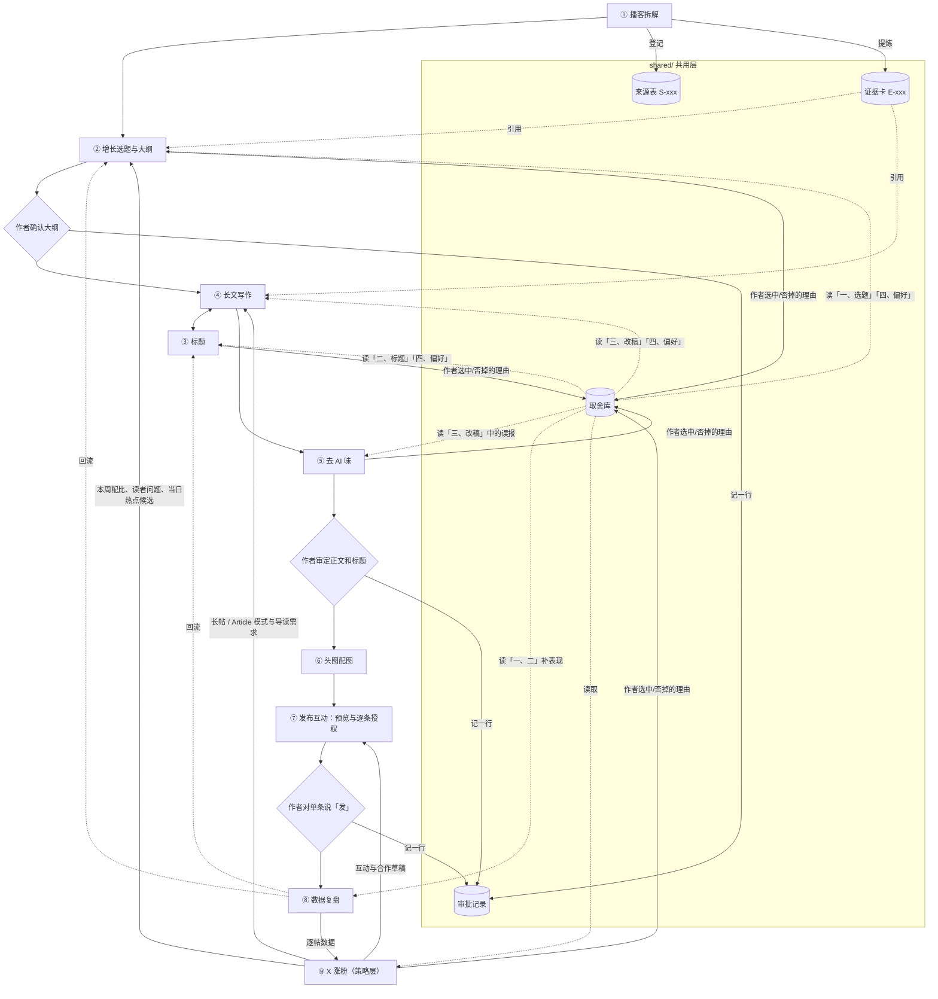

# X-operation-skills

一套给 AI Agent 用的 X 运营 Skill：把英文产品增长类播客做成中文增长干货，在 X 上发布、互动、复盘，并按周规划涨粉。

**适合谁用**：在 X 上写中文产品增长、AI 产品内容的个人作者或小团队；素材主要来自英文播客；希望每一步有证据可查、发布前由自己逐条审批，不想把账号交给自动化脚本。

一个仓库，9 个入口 Skill：8 个内容生产入口，加 1 个涨粉策略层。每个入口可以单独用，也可以按顺序串起来；它们共用同一套来源表、证据编号、审批记录和取舍库（`shared/` 层）。

内容的核心是获客、激活、留存、变现、扩张的具体动作、机制、证据和适用条件。传播角度只服务表达，不决定选题。

## 9 个入口总览

「典型触发语」是示例说法，换成你自己的话也能触发；各入口的准确触发条件以对应 SKILL.md 的 `description` 为准。

| # | 入口 | 做什么 | 典型触发语（示例） | 产出物 |
|---|---|---|---|---|
| ① | **[podcast-teardown](skills/podcast-teardown/SKILL.md) 播客拆解** | 登记来源、去重，复用或本地转写文字稿，校对说话人、专名、数字和引语，按增长环节提炼证据卡 | 「把这期播客拆成增长证据卡」 | 来源表、英文转写（原始稿与校正稿分开）、带时间戳的证据卡、疑点列表；大纲获批后补中英逐字稿和术语表 |
| ② | **[growth-topics](skills/growth-topics/SKILL.md) 增长选题** | 先过增长硬门槛，再按可执行性、信息增量、新近程度排序 | 「从这些证据卡里挑选题，出大纲」 | 3 个候选选题、推荐理由、带证据缺口的大纲，停在作者确认 |
| ③ | **[x-title](skills/x-title/SKILL.md) 标题** | 复用 X-title-skill；本地未安装时走简版流程 | 「给这篇拟几个标题」「帮我检查这个标题」 | 3–5 个不同角度的候选及兑现位置；选定后写入 `title.txt` 并锁定 |
| ④ | **[longform-writing](skills/longform-writing/SKILL.md) 长文写作** | 按获批大纲写中文增长长文，事实、嘉宾观点、本文推断分开 | 「按这个大纲写成 X 长帖」「写成 X Article」 | 正文、事实核验表、配图观点清单、待核问题 |
| ⑤ | **[de-ai-tone](skills/de-ai-tone/SKILL.md) 去 AI 味** | 按自写禁用写法检查，复核误报，最小改写，再逐项核对改了不走样 | 「把这篇去一下 AI 味」 | 问题与改法清单、最小改写稿、前后对照、语义复核结果 |
| ⑥ | **[cover-and-figures](skills/cover-and-figures/SKILL.md) 头图配图** | 先写清每张图要证明的观点，再选图型，用 HTML/CSS 本地渲染，对照源数据目检 | 「给这篇做头图和数据图」 | 头图两版、正文图；每张图的 HTML 源文件、PNG、源数据表、检查记录 |
| ⑦ | **[publish-engage](skills/publish-engage/SKILL.md) 发布互动** | 准备次日预览和回复草稿，作者对单条明确说「发」后才操作并回读确认 | 「准备明天的发布预览」「给这几条热门帖拟回复」 | 次日预览包、逐条互动草稿 |
| ⑧ | **[data-review](skills/data-review/SKILL.md) 数据复盘** | 用账号自己可见的数据记逐帖指标，对齐观察窗，对读 Top 与 Bottom | 「做一下本周的数据复盘」 | 逐帖指标表、周复盘（含下周一个低成本实验），回流选题和标题 |
| ⑨ | **[x-growth](skills/x-growth/SKILL.md) X 涨粉** | 策略层：当日 AI 热点联动增长视角、主页定位、一周计划与分发、互动与合作草稿、周度涨粉复盘；账号与目标只放本地配置 | 「排一下下周的发帖计划」「今天有哪些 AI 热点能讲增长」 | 当日热点候选、主页优化建议、一周增长计划（含分发清单）、互动与合作草稿、周度涨粉复盘 |

共用部分（`shared/`）：

- **[shared/workflow.md](shared/workflow.md) 流程与审批闸门**
- **[shared/evidence-rules.md](shared/evidence-rules.md) 来源与证据规则**：来源编号 `S-xxx`、证据编号 `E-xxx`、事实/嘉宾观点/本文推断三层分开
- **[shared/templates/decision-library.md](shared/templates/decision-library.md) 取舍库**：记录作者选中、否掉的选题、标题、改稿及原因，供各入口读取
- **[shared/templates/source-register.md](shared/templates/source-register.md) 来源表**、**[shared/templates/evidence-card.md](shared/templates/evidence-card.md) 证据卡**、**[shared/templates/approval-log.md](shared/templates/approval-log.md) 审批记录**

## 工作流



三道闸门：大纲确认前不写全文；正文和标题审定前不做图；作者对展示过的单条明确说「发」之前不发布。已获批的版本被改动后，重新走对应闸门。各入口读取取舍库的哪一部分，见 [取舍库模板](shared/templates/decision-library.md) 末尾的「各入口怎么读」。

## 安装

```bash
git clone https://github.com/huaxialucaicaizi/X-operation-skills.git
cd X-operation-skills
```

把需要的入口复制到你的 Agent 的 skills 目录，并把 `shared/` 放到 skills 目录的上一级（各入口通过 `../../shared/` 引用共用模板）。以 Claude Code 的用户级目录为例：

```bash
mkdir -p ~/.claude/skills
cp -r skills/* ~/.claude/skills/
cp -r shared ~/.claude/shared
```

复制后的目录关系：

```text
~/.claude/
├── shared/          # 共用层，与 skills/ 同级
└── skills/
    ├── podcast-teardown/
    ├── growth-topics/
    ├── ...
    └── x-growth/
```

其他 Agent 的 skills 目录位置以其文档为准，保持「`shared/` 在 skills 目录上一级」这个相对关系即可。只装单个入口时，没有 `shared/` 也能运行，但输出会注明「未读取共用来源表/取舍库」。

真实的来源表、取舍库、复盘数据，以及 X 涨粉的账号配置，建议放在仓库根目录的 `local/` 下（已在 `.gitignore` 中忽略），默认不公开：

```bash
mkdir -p local
cp skills/x-growth/templates/growth-config.example.md local/growth-config.md
cp shared/templates/decision-library.md local/decision-library.md
```

标题入口会优先调用作者的独立仓库 [X-title-skill](https://github.com/huaxialucaicaizi/X-title-skill)。它不是必装项，没装时 ③ 按自带的简版流程执行。

## 快速上手

下面的对话是示例，入口名写在括号里，方便你对照目录。Agent 每次停在闸门处等你确认，确认后才往下走。

### 场景一：日常发帖（一期播客走完整流程）

1. 「把这期播客拆一下：<单集链接>，目标读者是做 AI 产品增长的人。」（① 播客拆解）
   Agent 登记来源 `S-001`，产出带时间戳的证据卡 `E-001`、`E-002`……编号格式见 [证据规则](shared/evidence-rules.md)。
2. 「从这些证据卡里挑选题。」（② 增长选题）
   给出 3 个候选和一份大纲，大纲里标出证据缺口。你确认大纲并选定输出模式。
3. 「按这个大纲写。」（④ 长文写作，中途调用 ③ 标题）
   产出正文、事实核验表和 3–5 个标题候选。你选定标题后逐字锁定。
4. 「去一下 AI 味。」（⑤ 去 AI 味）你审定正文和标题。
5. 「做头图。」（⑥ 头图配图）
6. 「准备明天的发布预览。」（⑦ 发布互动）你看完预览，对这一条说「发」，Agent 才会在允许的浏览器界面操作，并回读确认。
7. 一周后：「做本周复盘。」（⑧ 数据复盘）结论回流到下一轮选题和标题。

### 场景二：X 长帖和 X Article，两种模式怎么选

模式在大纲确认时由你选定，规则见 [两种输出模式](skills/longform-writing/references/output-modes.md)。

| | X 长帖 | X Article |
|---|---|---|
| 适合的材料 | 一个增长动作、一条主证据 | 多个动作，或一个动作的完整链条 |
| 标题 | 通常没有独立标题，首句承担标题作用 | 独立标题 |
| 结构 | 不用小标题，靠段落顺序推进 | 可用小标题分节 |
| 配图 | 可选，通常 0–1 张 | 头图 + 按需正文图 |
| 模板 | [x-long-post.md](skills/longform-writing/templates/x-long-post.md) | [x-article.md](skills/longform-writing/templates/x-article.md) |

- 示例：「证据卡只讲了一个激活动作，写成 X 长帖。」
- 示例：「要对比两家公司的定价分层，还要画一张对比图，写成 X Article。」
- 拿不准时，② 会在大纲里两种模式各写一句理由，由你选。

两种模式的事实标准完全一样，模式只影响结构和篇幅。X Article 可以另配一条能独立读懂的导读帖，由 ⑨ 在分发清单里提出，单独审批。

### 场景三：只拟标题

「这是正文和核验表，给这篇拟标题。」（③ 标题）

- 本地装了 X-title-skill：直接调用它，并把正文、证据表和取舍库「二、标题取舍」一起传过去。
- 没装：按简版流程，先写一句「谁，遇到什么问题，这篇给出哪个答案」和一句「不承诺什么」，再出 3–5 个不同角度的候选，每个写明在正文哪里兑现。
- 只有主题、没有正文时，产出标为「方向草案」，不能当可发布候选。
- 你选定后标题写入 `title.txt` 逐字锁定，下游一字不改，配图时只能换行。

### 场景四：x-growth 热点联动

「今天的 AI 热点里，有哪些能讲增长打法？」（⑨ X 涨粉）

1. ⑨ 只从 `local/growth-config.md`「热点来源」里启用的来源找当日热点，每条记录来源、链接和看到的时间。
2. 每条热点先过和普通选题同一道[增长门槛](skills/growth-topics/references/topic-gates.md)；纯新闻、纯融资、纯模型跑分不选。
3. 过门槛的热点只挑一个最站得住的增长环节加视角，并标明「本文推断」及前提。
4. 结果写进[当日热点候选](skills/x-growth/templates/daily-hotspots.md)，你来选。模板里的示例行是虚构的，例如「示例产品 A 上线免费层」被归到「变现」环节。
5. 选中的热点有三种用法：
   - 当日主槽位：交 ② 选题、④ 写作，大纲照样先批。
   - 互动回复：交 ⑦，计入每日回复草稿上限。
   - 附加短帖：交 ⑦ 单独审批。

热点不改变周配比，热点内容按其类型（拆解、清单流程、方法总结）计入 4/2/1 配比。

## 配置说明（x-growth）

账号、目标、起止日期、语言、时间预算、热点来源都只放在本地配置 `local/growth-config.md` 里，从 [growth-config.example.md](skills/x-growth/templates/growth-config.example.md) 复制。没填的项保持「待补充」，⑨ 输出时原样写「待补充」，不猜。

| 项 | 默认值 | 说明 |
|---|---|---|
| 基线起算日期 | 示例值 `2026-11-07` | 改成你自己的起算日。启动时的粉丝基线要在这一天从账号实际页面记录，并写采样时间；仓库里不写任何具体粉丝数 |
| 目标粉丝数 | 待补充 | 是目标，不是效果承诺；⑨ 只算差额和每周所需净增，不预测能否达成 |
| 试行期 | 2 周 | 可在配置中改。试行期结束后，用 ⑧ 的数据和你的判断决定是否调整下面的试行值 |
| 每日主槽位 | 1 | 不为日更牺牲核验，材料不够当天可以空着 |
| 周配比 | 4 条案例/机制拆解 + 2 条操作清单/流程 + 1 条本周方法总结 | 试行值，不是算法最优比例 |
| 英文内容 | 每周 1–2 条 | 默认占用当日主槽位、不额外加量；可改为「额外发布」 |
| 每日回复草稿 | ≤ 3 条 | 试行值，是上限不是任务指标，没有值得回的就不写；每条单独批准 |
| 热点计入规则 | 固定 | 热点做主槽位时按类型计入周配比；热点下的互动回复计入每日回复草稿上限 |

### 热点来源（5 类，可配置）

| # | 来源类型 | 访问方式 |
|---|---|---|
| 1 | X 搜索关键词 | 浏览器手动，或允许的浏览器流程 |
| 2 | X 列表 | 同上 |
| 3 | 关注的账号 | 同上 |
| 4 | 资讯站 / 新闻订阅 | 公开网页 / RSS |
| 5 | 作者手动提供 | 作者粘贴当日链接 |

每类都可以单独启用或关闭、增删行。仓库不写死任何账号、榜单或服务。同一份配置里还可以设「每日热点候选数量上限」和「热点关注领域关键词」，两项默认都是「待补充」。

以下几项不是配置项，任何配置都打不开：自动发布、自动回复、自动关注/取关/点赞/私信、付费 X API、读取 Cookie、定时任务。

## 去 AI 味原则

⑤ 去 AI 味的目标是用白话和自然节奏表达，清掉套路，信息一点不变。完整规则见 [禁用写法](skills/de-ai-tone/references/banned-patterns.md) 和 [改了不走样](skills/de-ai-tone/references/meaning-preservation.md)。

- **优先级**：信息和确定程度不变，排第一；编辑范围不越界，排第二；作者声音不变，排第三；表达问题最后才看。
- **最小改写**：只改有问题的句子，通顺的段落原样保留，不为展示工作量强改。
- **逐项对照**：每处改写都核对数字与单位、否定、条件、时间、归因、因果、确定程度、范围、比较对象，任一项走样就撤回这处改写。
- **保护范围**：引语、逐字稿、专名、代码、锁定标题整段跳过。
- **12 类禁用写法**：翻案腔、结论提示冒号、破折号当连接、分号长句、正文里的箭头、机械三连、同义换名、生造比喻、审稿批注腔、半中半英黑话、数字加形容词、结尾拔高。命中只是线索，要回到上下文判断。
- **误报会被记住**：你拒绝过的改法在取舍库里归为「误报」，下次同类句子默认不报。
- **不做 AI 检测**：这是风格偏好，不输出「AI 概率」；不为命中数清零删事实、删限定、删归因。

## 这个套件不做什么

- 不编造数据、引语、亲历、测试、来源或算法结论；未知写「待补充」
- 不改事实，不夸大
- 不预测点击率、曝光、涨粉或「爆款概率」
- 不自动发布，不自动点赞、评论、私信、关注
- 不使用付费 API，不读取 Cookie，不绕过登录或失败
- 不引用未经验证的算法说法（例如「外链必限流」「黄金 15 分钟」）

## 目录结构

```text
X-operation-skills/
├── README.md
├── CHANGELOG.md
├── LICENSE                     # 非商业许可
├── .github/workflows/ci.yml    # 每个 PR 运行 scripts/validate.py
├── scripts/
│   └── validate.py             # frontmatter、必需文件、相对链接、README 规则校验
├── shared/                     # 共用层
│   ├── workflow.md             # 流程与审批闸门
│   ├── evidence-rules.md       # 来源与证据规则
│   └── templates/
│       ├── source-register.md  # 来源表
│       ├── evidence-card.md    # 证据卡
│       ├── approval-log.md     # 审批记录
│       └── decision-library.md # 取舍库
└── skills/                     # 9 个入口，每个含 SKILL.md、references/、templates/
    ├── podcast-teardown/       # ① 播客拆解
    ├── growth-topics/          # ② 增长选题
    ├── x-title/                # ③ 标题
    ├── longform-writing/       # ④ 长文写作（x-long-post / x-article 两个模板）
    ├── de-ai-tone/             # ⑤ 去 AI 味
    ├── cover-and-figures/      # ⑥ 头图配图
    ├── publish-engage/         # ⑦ 发布互动
    ├── data-review/            # ⑧ 数据复盘
    └── x-growth/               # ⑨ X 涨粉（含 growth-config.example.md）
```

`local/` 不在仓库里，由你在本地创建，存放真实数据和配置。

## 校验

```bash
python3 scripts/validate.py
```

检查每个 SKILL.md 的 frontmatter、必需文件、相对链接，以及 README 中是否误加了徽章或旧仓库名。CI 在每个 PR 上自动运行。

## 常见问题

**必须 9 个入口全装、按顺序用吗？**
不用。每个入口都能单独触发，例如只用 ③ 拟标题，或只用 ⑤ 改稿。按顺序串起来时，闸门和取舍库才能发挥完整作用。

**没有 `shared/` 能运行吗？**
能。入口会按各自 SKILL.md 的最低要求执行，并在输出里注明「未读取共用来源表/取舍库」。想要证据编号和取舍记录跨入口复用，就把 `shared/` 放到 skills 目录的上一级。

**它会替我自动发帖、回复或关注别人吗？**
不会。⑦ 和 ⑨ 只出预览、候选和草稿。你对展示过的单条、账号、渠道、版本明确说「发」，才会在允许的浏览器界面操作；改稿后要重新确认。主页的 bio、横幅、链接、置顶也各自单独批准。

**4/2/1 配比和每日 ≤ 3 条回复是最优值吗？**
不是。它们是试行值，默认先跑 2 周（可在配置里改试行期），之后用 ⑧ 的真实数据和你的判断再调。套件不宣称任何比例或时段是算法最优。

**热点从哪里来？需要付费 API 吗？**
只从你在 `local/growth-config.md` 里启用的 5 类来源中取，不用付费 X API，不买数据服务，不读 Cookie。来源访问不了，会在当日候选里列为「未能访问的来源」。

**我的账号数据、取舍记录会被提交到仓库吗？**
只要放在 `local/` 下就不会，这个目录已被 `.gitignore` 忽略。仓库里的模板只含空表、占位符和标注为虚构的示例行。

## 致谢

本套件的规则和流程由作者自定，以下项目只提供方法上的参考。除特别说明外，均为借鉴思路、用自己的话重写，未复制原文。许可信息来自各仓库的 LICENSE 文件或 GitHub API。

| 项目 | 许可 | 借鉴了什么 | 用在哪里 |
|---|---|---|---|
| [huaxialucaicaizi/X-title-skill](https://github.com/huaxialucaicaizi/X-title-skill) | 作者本人仓库 | 标题方法整体复用 | 标题 |
| [op7418/Humanizer-zh](https://github.com/op7418/Humanizer-zh) | MIT，Copyright (c) 2026 歸藏 | 「改了不走样」：信息与确定程度守恒、作者声音、逐项对照（归纳重述） | 去 AI 味 |
| [AugustusW/audio-tldr-skill](https://github.com/AugustusW/audio-tldr-skill) | MIT | 转写缓存、原稿与校正稿分开、专名记录 | 播客拆解 |
| [SYSTRAN/faster-whisper](https://github.com/SYSTRAN/faster-whisper) | MIT | 仅作为可选的本地转写工具 | 播客拆解 |
| [coreyhaines31/marketingskills](https://github.com/coreyhaines31/marketingskills) | MIT | 受众问题、信息增量检查、内容复用；账号自身数据与反馈循环 | 增长选题、数据复盘、X 涨粉 |
| [Gracker/gracker-writing](https://github.com/Gracker/gracker-writing) | MIT | 事实强度、整稿与局部审查分开 | 长文写作 |
| [criccomini/write-like-paul-graham](https://github.com/criccomini/write-like-paul-graham) | MIT | 先论点骨架、前几段给答案 | 长文写作 |
| [codejunkie99/x-article-skills](https://github.com/codejunkie99/x-article-skills) | 未识别 | 只借鉴「早给价值、讲清作者增量」的思路，未复制任何文本 | 长文写作 |
| [JimLiu/baoyu-skills](https://github.com/JimLiu/baoyu-skills) | MIT | 信息结构与视觉风格分开、按信息关系选图型；发布前预览与图片位置检查 | 头图配图、发布互动 |
| [Jakeschincariol/x-agent-skill](https://github.com/Jakeschincariol/x-agent-skill) | MIT | 回复分诊；账号自身数据、每千曝光指标、统一观察窗；x-plan 的周计划统筹内容与互动、主页承诺与置顶一致 | 发布互动、数据复盘、X 涨粉 |

可选外部工具（本仓库未包含、未复制其任何内容）：[larashero3-dotcom/lieflat-less-ai-tone](https://github.com/larashero3-dotcom/lieflat-less-ai-tone)（CC BY-NC 4.0）。去 AI 味入口只写「本地装了就调用」，许可是否适用由使用者自行确认。

## 作者

华夏路菜菜子：前大厂 AI 产品增长，现 AI 创业者

## 许可

非商业许可，见 [LICENSE](LICENSE)。未经作者事先书面许可，不得商用，也不得将本项目上架、收录或分发到第三方 AI 产品、Skill 商店或类似渠道。联系：GitHub [@huaxialucaicaizi](https://github.com/huaxialucaicaizi)。

变更记录见 [CHANGELOG.md](CHANGELOG.md)。
